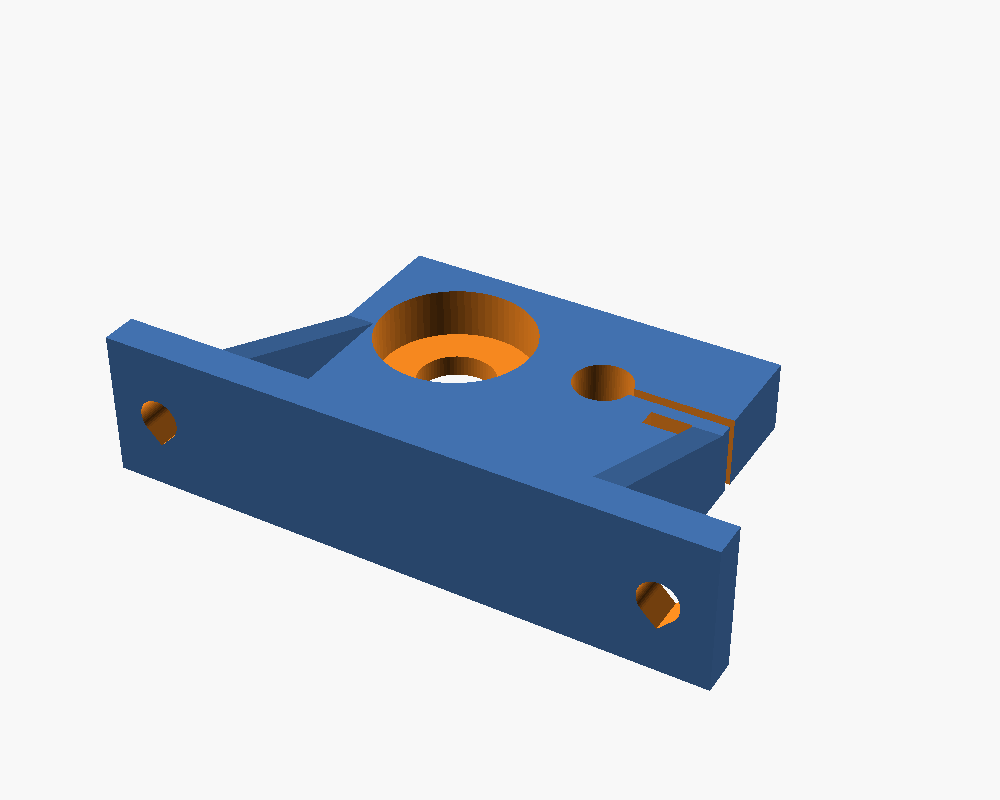

# Obere Z-Halterung (2020-Profil, 608-Lager + 8-mm-Stange)

- `z_top_halter_rechts.stl` / `z_top_halter_links.stl`: fertig zum Drucken (Stange rechts bzw. links neben der Spindel)
- `z_top_halter.scad`: parametrische Quelle für OpenSCAD (Maße oben in der Datei)

## Drucken
So hinlegen, wie die STL liegt: Arm flach auf dem Bett, Rückwand steht senkrecht.
**Keine Stützen nötig.** Empfehlung: 4 Wände, 40 % Infill, PETG oder PLA.

## Einbau
Wird umgedreht montiert: die Bettseite zeigt nach oben und schließt bündig mit der Oberkante des Profils ab.
- 608-Lager von unten in den Sitz drücken
- 8-mm-Stange von unten durchschieben, mit M3x16–20 von der Vorderkante + M3-Mutter (Schlitz) klemmen
- 2x M5x10 + Nutenstein ins 2020-Profil

## Vor dem Drucken nachmessen
| Variable | Standard | Bedeutung |
|---|---|---|
| `achs_abstand` | 30 | Profil-Vorderseite bis Mitte Spindel/Stange |
| `mitten_abstand` | 22 | Mitte Spindel bis Mitte Stange |
| `lager_d` | 22.2 | Lagersitz (608 = 22 mm + Spiel) |
| `stange_d` | 8.2 | Stangenbohrung |

Neue STL erzeugen: `openscad -D achs_abstand=35 -o halter.stl z_top_halter.scad`
