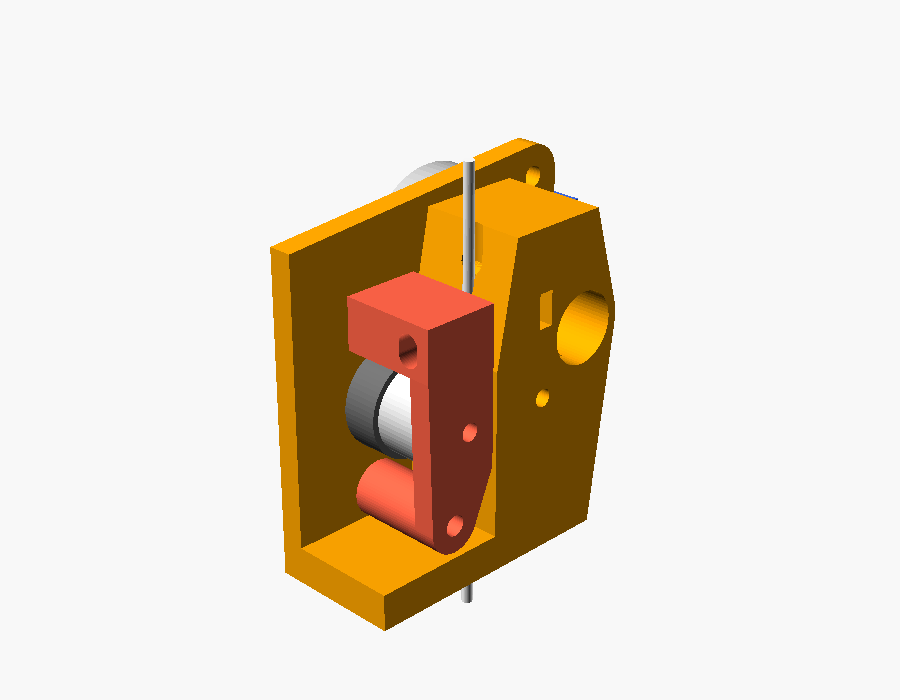

# Direktextruder mit 28BYJ-48

Ein leichter Direktextruder aus dem kleinen 28BYJ-48-Schrittmotor und einem Paar
Dual-Drive-Zahnräder (Zahnkranz plus gerändelte Stahlscheibe mit Lager).



Das Modell `extruder.scad` ist parametrisch. Bevor du druckst, trägst du die Maße
deiner Zahnräder ein (siehe [Messen](#1-messen)).

---

## Was du erwarten kannst

Der 28BYJ-48 ist leicht (35 g) und billig. Er hat aber wenig Kraft und dreht
langsam, weil im Gehäuse schon ein Getriebe von etwa 64 : 1 steckt.

| | 28BYJ-48 (dieser Bau) | üblicher NEMA17-Extruder |
|---|---|---|
| Gewicht Motor | 35 g | 200–350 g |
| Vorschubkraft | etwa 10–20 N | 50–100 N |
| Förderleistung | etwa 3–6 mm³/s | 15–30 mm³/s |

Mit 3–6 mm³/s druckst du mit einer 0,4-mm-Düse und 0,2-mm-Schichten etwa
**30–60 mm/s**. Das reicht für PLA und PETG, wenn du langsam druckst. Für
schnelles Drucken reicht es nicht. Diese Werte sind Abschätzungen: Wie viel er
wirklich schafft, hängt von der Spannung, dem Strom und deinen Zahnrädern ab.

**Verwende die große schwarze Zahnradstufe nicht.** Das große Zahnrad mit dem
Metallritzel untersetzt noch einmal etwa 5 : 1. Der Motor hat dann zwar viel Kraft,
fördert aber nur noch rund 1 mm/s Filament. Das ist für den Druck zu langsam.
Deshalb treibt hier ein gedrucktes Ritzel auf der Motorwelle direkt den Zahnkranz
eines Antriebsrads an.

## Funktionsweise

```
            Filament (von oben)
                  │
   Ritzel ◯──▶ (A)│(B) ◀── Feder
   (Motorwelle)   │   │
                  │   ● Drehpunkt des Spannhebels
                  ▼
               Hotend
```

- Der Motor sitzt hinten an der Rückwand.
- Das Ritzel treibt Rad **A** an, das auf einer festen 3-mm-Achse dreht.
- Rad **B** sitzt im Spannhebel und greift in A. Deshalb ziehen beide Räder am
  Filament (Dual Drive).
- Eine M3-Schraube mit Feder drückt den Hebel und damit B gegen das Filament.

---

## 1. Messen

Öffne `extruder.scad` in [OpenSCAD](https://openscad.org) und trage im Abschnitt
**MESSEN** die Maße deiner Räder ein. Die voreingestellten Werte sind nur aus dem
Foto geschätzt.

| Parameter | Was du misst |
|---|---|
| `rad_zaehne` | Zähne am schwarzen Zahnkranz (am besten mit Filzstift markieren und zählen) |
| `rad_aussen_d` | Durchmesser über die Zahnspitzen |
| `rad_breite` | Gesamtbreite eines Rads |
| `rad_zahnkranz_breite` | Breite nur des schwarzen Zahnkranzes |
| `rad_raendel_d` | Außendurchmesser der Stahl-Rändelscheibe |
| `achse_d` | Innendurchmesser des Lagers im Rad (meist 3 mm) |

Aus Zähnezahl und Außendurchmesser rechnet das Modell das **Modul** der
Verzahnung aus (`Außen-Ø / (Zähne + 2)`). Danach baut es ein Ritzel, das passt.

Unten in der Konsole zeigt OpenSCAD die Ergebnisse an:

```
ECHO: "Modul: 0.5 mm"
ECHO: "Ritzel: 18 Zähne, Außen-Ø 10 mm"
ECHO: "Untersetzung Ritzel -> Rad: 1.72222 : 1"
ECHO: "Spalt zwischen den Rändeln: 1 mm (Filament 1.75 mm)"
```

Der Spalt zwischen den Rändeln muss **kleiner** sein als das Filament, sonst greifen
die Räder nicht. Ist er zu groß, stimmen meist die gemessenen Maße nicht.

Für den Motor sind die Werte aus dem Datenblatt eingetragen. Prüf nur nach, ob die
Laschenlöcher 35 mm auseinander liegen und wie weit die Welle herausragt
(`welle_laenge`, ab der Montagefläche gemessen).

## 2. Drucken

Stell oben im Modell `teil` auf `gehaeuse`, `hebel` oder `ritzel`. Drück dann F6
und exportiere die STL. Mit `plan` liegen alle drei Teile nebeneinander.

- **Material:** PETG, ABS oder ASA. PLA wird neben dem Hotend weich.
- **Gehäuse und Hebel:** 0,2-mm-Schichten, 4 Wände, 40 % Füllung. Das Gehäuse
  liegt auf der Rückwand. Über der Radkammer entsteht eine Brücke von etwa 17 mm.
  Gelingt die nicht sauber, setz nur dort Stützmaterial.
- **Ritzel:** möglichst fein drucken, mit 0,1-mm-Schichten oder einer 0,2-mm-Düse.
  Bei Modul 0,5 sind die Zähne sehr klein. Es sitzt mit leichtem Presssitz auf der
  abgeflachten Welle.

## 3. Teile

| Anzahl | Teil |
|---|---|
| 1 | 28BYJ-48 (umgebaut auf bipolar, siehe unten) |
| 2 | Dual-Drive-Antriebsräder |
| 2 | Stahlstift 3 × 20 mm als Achse (z. B. abgesägter Bohrer- oder Passstift) |
| 2 | M4 × 8 (oder M3 × 8 mit Scheibe) für die Motorlaschen |
| 1 | M3 × 20 als Drehpunkt des Hebels |
| 1 | M3 × 30 mit Mutter und Druckfeder (Ø 4–5 mm, ca. 10 mm lang) |
| 2 | M3-Schrauben für die Befestigung unten (Abstand 20 mm, `befestigung_abstand`) |
| | PTFE-Schlauch 4 × 2 mm vom Extruder bis in den Heatbreak |

## 4. Zusammenbau

1. Setz das Ritzel von vorn durch die runde Öffnung auf die Motorwelle.
2. Schraub den Motor hinten an die Rückwand. Die Welle zeigt in die Radkammer.
3. Schieb Rad A seitlich in die Kammer, Zahnkranz nach hinten (zum Motor).
   Drück dann die Achse von vorn durch Gehäuse und Rad.
4. Drück Achse B in den Spannhebel und steck Rad B auf.
5. Schraub den Hebel mit der M3 × 20 am Drehpunkt unten an.
6. Leg die M3-Mutter von vorn in den Schlitz oben links. Steck die M3 × 30 von
   rechts durch die Feder, durch den Hebel und in die Mutter.
7. Zieh die Federschraube nur so weit an, dass das Filament gut gefördert wird und
   die Rändel sichtbare, aber flache Spuren hinterlassen.

---

## 5. Motor auf bipolar umbauen

Im Original wird der 28BYJ-48 mit einer ULN2003-Platine angesteuert. Dein
Drucker-Mainboard hat aber Treiber für bipolare Motoren (A4988, TMC2208/2209 usw.).
Mit einem kleinen Eingriff läuft der Motor daran. Er bekommt dabei auch mehr
Drehmoment.

1. Hebel die blaue Kunststoffkappe am Kabelausgang vorsichtig ab.
2. Darunter liegt eine kleine Platine mit drei Leiterbahnen. Trenn die **mittlere**
   Bahn mit einem Cutter durch. Sie verbindet die beiden Mittelanzapfungen mit dem
   roten Kabel.
3. Prüf mit dem Multimeter:
   - **Orange – Pink** ist Spule A und zeigt einen Widerstand.
   - **Gelb – Blau** ist Spule B und zeigt einen Widerstand.
   - Orange – Gelb zeigt **keine** Verbindung mehr.
4. Das rote Kabel bleibt frei. Isolier es.
5. Schließ an den Extruder-Anschluss des Boards an: A1/A2 = Orange/Pink,
   B1/B2 = Gelb/Blau. Läuft der Motor falsch herum, dreh in der Firmware die
   Richtung um.

Die Farben im Stecker liegen oft in der Reihenfolge Blau, Pink, Gelb, Orange, Rot.
Die Pins passen deshalb meist **nicht** direkt auf den Board-Stecker. Steck sie um.

### Strom einstellen

Der kleine Motor wird schnell heiß. Für die Wärme gilt: Leistung je Spule = I² × R.

- Miss den Widerstand einer Spule. Laut Datenblatt sind es etwa 100 Ω (2 × 50 Ω).
- Fang mit **0,08 A** (RMS) an. Fass den Motor nach 10 Minuten Druck an. Bleibt er
  unter etwa 60 °C, kannst du langsam bis 0,10 A gehen.
- Mehr Spannung am Board (24 V statt 12 V) erhöht die Drehzahl, die er noch schafft.
  Den Strom regelt der Treiber, also wird der Motor davon nicht heißer.

---

## 6. Firmware

Die Werte unten gelten für die Voreinstellungen (18er-Ritzel, 31er-Rad,
wirksamer Durchmesser etwa 13,75 mm). Setz deine eigenen Zähnezahlen ein und
kalibrier danach den Vorschub (100 mm anfordern, nachmessen).

Im 28BYJ-48 steckt nicht genau 64 : 1, sondern **63,684 : 1**. Der Rotor hat
32 Vollschritte pro Umdrehung.

### Klipper

```ini
[extruder]
# step_pin, dir_pin, enable_pin, nozzle, heater ... wie bisher
microsteps: 16
full_steps_per_rotation: 32
gear_ratio: 63.684:1, 31:18
rotation_distance: 43.2          # π × wirksamer Durchmesser, kalibrieren
max_extrude_only_velocity: 5
max_extrude_only_accel: 300
max_extrude_cross_section: 1.0

[tmc2209 extruder]
# uart_pin wie bisher
run_current: 0.08
stealthchop_threshold: 999999
```

### Marlin

Schritte pro mm = 32 × Mikroschritte × 63,684 × (Radzähne / Ritzelzähne) /
(π × wirksamer Durchmesser)

Für die Voreinstellungen mit 16 Mikroschritten:

```
M92 E1300        ; Schritte/mm, danach kalibrieren
M203 E5          ; maximale Extrudergeschwindigkeit in mm/s
M201 E300        ; Beschleunigung
M906 E80         ; Strom in mA (nur TMC-Treiber)
M500             ; speichern
```

### Slicer

- **Rückzug:** 0,5–1,0 mm bei 5 mm/s (Direktextruder brauchen wenig)
- **Maximaler Volumenstrom:** zuerst 4 mm³/s eintragen und mit einem Flow-Test
  hochtasten. Ab dem Wert, bei dem der Motor Schritte verliert (Klacken), 20 %
  abziehen.
- Eine höhere Düsentemperatur (+10 °C) senkt die nötige Kraft deutlich.

---

## Anpassen

- **Hotend-Befestigung:** unten sind zwei Löcher für M3 (Abstand
  `befestigung_abstand`, Durchmesser `befestigung_loch_d`). Für Einschmelzmuttern
  setzt du `befestigung_loch_d = 4.0`. Für einen anderen Drucker muss der Sockel
  vermutlich angepasst werden.
- **Lage des Motors:** `ritzel_winkel` dreht das Ritzel um Rad A herum,
  `motor_richtung` dreht den Motorkörper um seine Welle.
- **Zahnspiel:** Klemmt das Ritzel, erhöhst du `zahnspiel` (z. B. 0,15). Hat es zu
  viel Spiel, verringerst du ihn.
