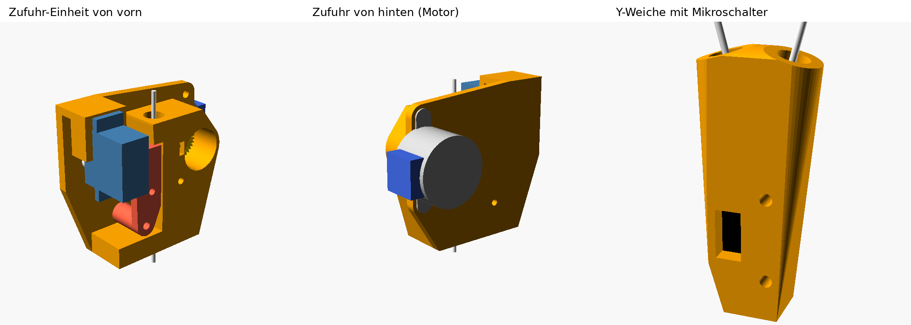

# Filamentwechsler für den Ender 3 (2 Filamente, Klipper)

Zwei Zufuhr-Einheiten mit je einem 28BYJ-48 schieben abwechselnd ihr Filament in
eine Y-Weiche. Von dort läuft es in den normalen Bowden-Extruder des Ender. Der
Ender-Extruder druckt wie gewohnt. Der Wechsler bringt nur das richtige Filament
bis zu ihm und parkt das andere.



```
 Rolle 0        Rolle 1
    │              │
 [Zufuhr 0]     [Zufuhr 1]      28BYJ-48 + Servo, am Rahmen
    │              │
    └──► Y-Weiche ◄┘            Mikroschalter unter dem Zusammenlauf
            │
     Ender-Extruder             unverändert
            │  Bowden
         Hotend
```

## Warum ein Servo?

Das Getriebe im 28BYJ-48 lässt sich kaum von außen drehen. Würde die Zufuhr das
Filament dauernd festklemmen, müsste der Ender-Extruder während des Drucks gegen
den Motor ziehen. Deshalb drückt ein kleiner Servo den Spannhebel **nur während
des Wechsels** an. Im Druck ist der Servo stromlos und das Filament läuft frei
durch die Zufuhr.

Kraft braucht die Zufuhr kaum: Sie schiebt das Filament nur etwa 10 cm durch die
Weiche bis zum Ender-Extruder. Die lange Strecke durch den Bowden übernimmt der
Ender-Extruder. Deshalb läuft die Zufuhr 1 : 1 ohne Untersetzung.

## Ablauf eines Wechsels (T0 → T1)

1. Der Slicer formt die Filamentspitze (Ramming) und ruft `T1` auf.
2. Der Ender-Extruder zieht Filament 0 aus Düse und Bowden, bis die Spitze knapp
   hinter seinen Zahnrädern liegt.
3. Servo 0 drückt an. Zufuhr 0 zieht zurück, bis der Schalter in der Weiche frei
   wird, und dann noch ein Stück, bis die Spitze hinter dem Zusammenlauf parkt.
   Servo 0 lässt los.
4. Servo 1 drückt an. Zufuhr 1 schiebt, bis der Schalter Filament meldet, und
   dann weiter bis kurz vor den Ender-Extruder.
5. Zufuhr 1 und Ender-Extruder schieben gemeinsam 20 mm, damit der Extruder das
   Filament sicher greift. Servo 1 lässt los.
6. Der Ender-Extruder schiebt Filament 1 bis zur Düse. Der Slicer spült auf dem
   Reinigungsturm.

Ein Wechsel dauert so etwa 1 bis 1,5 Minuten.

---

## 1. Teile

| Anzahl | Teil | ca. Preis |
|---|---|---|
| 2 | 28BYJ-48, auf bipolar umgebaut (README.md, Abschnitt 5) | 2 € |
| 2 | Paar Dual-Drive-Antriebsräder | |
| 2 | Servo MG90S (Metallgetriebe; SG90 geht auch) | 3 € |
| 1 | Raspberry Pi Pico | 5 € |
| 2 | Schrittmotortreiber A4988 oder TMC2208 (Stepstick) | 2–4 € |
| 1 | Spannungswandler 24 V → 5 V, mind. 2 A (für die Servos) | 2 € |
| 1 | Mikroschalter mit Hebel (KW10, wie der Endschalter am Ender) | 1 € |
| 5 | PC4-M10-Steckkupplungen | |
| | PTFE-Schlauch 4 × 2 mm | |
| 2 | Elko 100 µF / 35 V an der Motorspannung der Treiber | |
| 4 | Stahlstift 3 × 20 mm als Radachse | |
| | M3- und M2-Schrauben | |

Pro Zufuhr druckst du ein Gehäuse, einen Hebel und ein Ritzel (`extruder.scad`
mit `bauform = "wechsler"`). Die Weiche druckst du einmal (`weiche.scad` mit
`teil = "weiche"`).

## 2. Aufbau am Ender 3

- Die beiden Zufuhren kommen oben an den Rahmen, nahe an die Rollen. Befestigt
  werden sie über die Löcher im Sockel unten, z. B. mit einem Winkel an der
  2040-Querstrebe.
- Die Weiche sitzt dicht vor dem Ender-Extruder. Der Schlauch von der Weiche zum
  Extruder soll kurz sein (5–10 cm), denn diese Strecke ist `sensor_bis_extruder`.
- Für die Schläuche Zufuhr → Weiche reichen 20–40 cm, gerne mit sanften Bögen.
- Der Ender-Extruder braucht an seinem Eingang eine PC4-M10-Kupplung oder ein
  gerades Stück PTFE, damit das Filament von der Weiche sauber hineinfindet.

### Zufuhr zusammenbauen

Wie beim Extruder (README.md, Abschnitt 4), mit zwei Unterschieden:

- **Ohne Feder und Federschraube.** Der Hebel hängt frei.
- **Servo:** Steck den Servo von vorn, mit der Welle voran, durch das Fenster der
  Halteplatte und schraub ihn mit seinen zwei Schrauben fest. Kürz einen
  einarmigen Servohebel auf etwa 10 mm (`servo_hebel_r`). Setz ihn so auf, dass er
  waagrecht nach links gegen den Kopf des Spannhebels drückt.

## 3. Verkabelung

Der Pico hängt per USB am Raspberry Pi, auf dem Klipper läuft.

| Pico | geht an |
|---|---|
| GP2 / GP3 / GP4 | Treiber 0: STEP / DIR / EN |
| GP6 / GP7 / GP8 | Treiber 1: STEP / DIR / EN |
| GP14 | Servo 0, Signal (orange) |
| GP15 | Servo 1, Signal (orange) |
| GP10, GP11, GP12 | alle drei an denselben Anschluss des Mikroschalters (NO) |
| GND | zweiter Anschluss des Mikroschalters (COM), Treiber-GND, Servo-GND, 5-V-Wandler GND |
| 3V3 | VDD beider Treiber |

- **Motorspannung der Treiber (VMOT):** 24 V vom Netzteil des Ender, mit je einem
  100-µF-Elko direkt am Treiber.
- **Servos:** Plus (rot) an den 5-V-Wandler, **nicht** an den Pico. Ein Servo zieht
  beim Anlaufen kurz bis zu 0,7 A.
- **Microstepping:** Beim A4988 legst du MS1, MS2 und MS3 auf 3V3 (1/16). Beim
  TMC2208 ohne Brücken sind es 1/8. Dann trägst du in `wechsler.cfg`
  `microsteps: 8` ein.
- **Strom:** Er wird mit dem kleinen Poti auf dem Treiber eingestellt. Für den
  28BYJ-48 sind das nur etwa 0,1 A Spitze. Das entspricht einer Vref von etwa
  **0,08 V** beim A4988 (Messwiderstand 0,1 Ω) und etwa **0,1 V** beim TMC2208.
  Dreh das Poti zuerst ganz zurück und dann langsam hoch, bis der Motor sauber
  läuft. Der Motor darf nur handwarm werden.

### Klipper auf den Pico

```bash
cd ~/klipper
make menuconfig        # Micro-controller: Raspberry Pi RP2040, Rest Standard
make
# Pico mit gedrückter BOOTSEL-Taste anstecken, dann:
make flash FLASH_DEVICE=2e8a:0003
ls /dev/serial/by-id/  # Namen in wechsler.cfg bei [mcu wechsler] eintragen
```

Kopier `klipper/wechsler.cfg` neben die `printer.cfg` und ergänze dort:

```ini
[include wechsler.cfg]

[extruder]
# ... deine bisherigen Werte, zusätzlich:
max_extrude_only_distance: 600
```

## 4. Einrichten und Kalibrieren

Arbeite die Schritte der Reihe nach ab. Die Werte trägst du im Makro `WECHSLER`
in `wechsler.cfg` ein und machst danach einen `RESTART`.

1. **Sensor:** `QUERY_FILAMENT_SENSOR SENSOR=weiche` mit und ohne Filament im
   Kanal ausführen. Meldet er es falsch herum, nimm bei allen drei Pins das `!`
   weg.
2. **Servos:** Mit `SERVO_TEST T=0 WINKEL=60` den Winkel suchen, bei dem der
   Hebel fest andrückt. Das wird `servo_zu`. Dann den Winkel suchen, bei dem er
   frei ist; das wird `servo_offen`. Dasselbe mit `T=1`.
3. **Richtung und Vorschub:** Filament in Zufuhr 0 stecken. `ZUFUHR_TEST T=0
   WEG=100` muss es 100 mm **zur Weiche hin** schieben. Läuft es falsch herum,
   setz bei `dir_pin` ein `!` davor bzw. nimm es weg. Weicht die Länge ab, gilt:
   `rotation_distance` neu = alt × gemessen / 100.
4. **Wege:** Miss am Drucker nach und trag die Werte ein:
   - `sensor_bis_extruder`: vom Schalter in der Weiche bis zu den Zahnrädern des
     Ender-Extruders
   - `laden_weg`: von den Zahnrädern des Ender-Extruders bis zur Düse (beim
     Ender 3 meist Bowden-Länge + etwa 50 mm)
   - `entladen_weg`: `laden_weg` + 15 mm. Der Wert muss **kleiner** sein als
     `laden_weg` + `sensor_bis_extruder`. Sonst zieht der Extruder die Spitze
     schon über den Schalter hinaus.
5. **Probelauf ohne Druck:** Düse heizen, dann `WECHSLER_SETZEN T=-1`, `T0`,
   `T1`, `T0`. Schau bei jedem Schritt zu.

## 5. Slicer (OrcaSlicer oder PrusaSlicer)

- **Druckereinstellungen:** Extruder-Anzahl 2 und „Single Extruder Multi
  Material“ einschalten.
- **Werkzeugwechsel-G-Code:** `T[next_extruder]`
- **Start-G-Code** (am Ende): `WECHSLER_SETZEN T=-1` und danach
  `T[initial_extruder]`
- **End-G-Code:** `WECHSLER_ENTLADEN`
- **Reinigungsturm** einschalten, Spülmenge zuerst großzügig (ca. 150 mm³).
- **Filament → Multimaterial:** Ramming eingeschaltet lassen. Die Werte für
  Kühlbewegungen dort einstellen, wo der Slicer sie anbietet.

### Die Filamentspitze

Das ist bei jedem Einzeldüsen-Wechsler der heikelste Punkt, unabhängig von der
Zufuhr. Wird die Spitze beim Herausziehen dick oder zieht einen Faden, bleibt sie
im Bowden oder in der Weiche hängen. Hilfreich sind:

- Ramming im Slicer und mehrere Kühlbewegungen
- 5–10 °C weniger Temperatur beim Wechsel
- Ein PTFE-Schlauch, der bis zur Düse reicht, wie beim Original-Ender. Der hilft
  hier sogar.

Probier das zuerst mit PLA aus, bevor du PETG nimmst.

## Grenzen

- **Zeit:** etwa 1–1,5 Minuten pro Wechsel. Für Drucke mit wenigen Wechseln (z. B.
  Farbwechsel nach Schichten) passt das gut. Für hunderte Wechsel wird es lang.
- **Klemmen:** Bleibt die Spitze hängen, findet die Zufuhr den Schalter nicht.
  Klipper bricht den Druck dann mit einer Fehlermeldung ab, statt zwei Filamente
  in die Weiche zu schieben.
- **Nicht getestet:** Die Maße für Räder, Servo und Mikroschalter sind Schätzungen.
  Miss sie nach, bevor du druckst (`MESSEN` in den .scad-Dateien).
